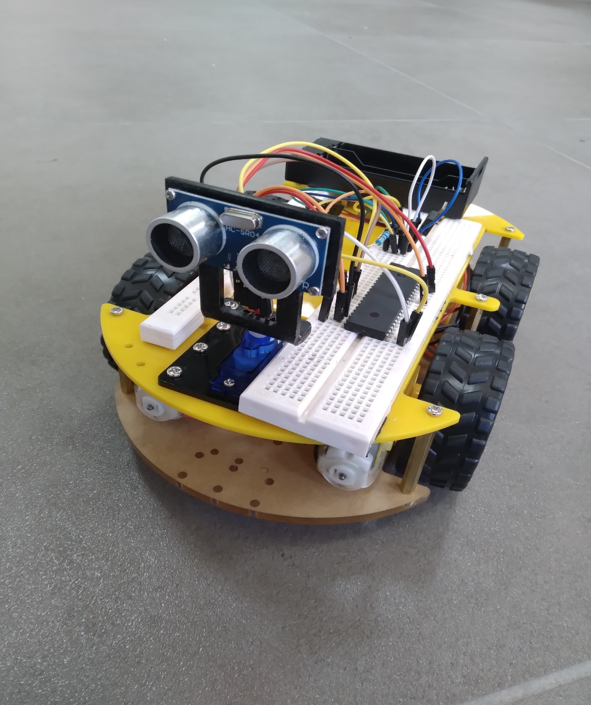
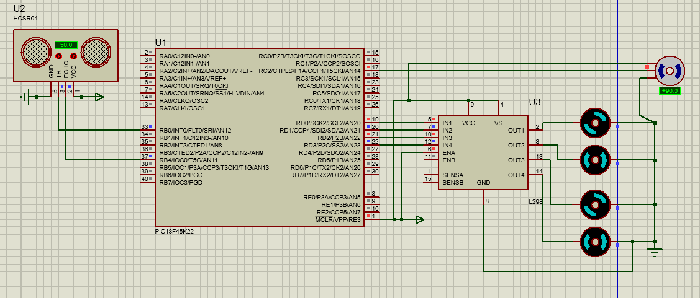

# Obstacle Avoiding Robot Car

A 4WD robot car on a PIC18F45K22, written in C, that drives forward and backs up and turns when the HC-SR04 sensor sees an obstacle closer than 20 cm.

## Features

- Measures distance with an HC-SR04 ultrasonic sensor timed by Timer1 (about 58 us per cm).
- Under 20 cm: stop, reverse for 0.5 s, turn right, then continue forward.
- Four DC motors driven through an L298N H-bridge with plain digital logic (no PWM speed control).
- SG90 servo PWM generated in a Timer0 interrupt so the sensor can look left, centre and right (scan code is present but disabled in the final run, see Results).

## Hardware and stack

- PIC18F45K22, internal oscillator at 4 MHz
- HC-SR04 ultrasonic sensor (TRIG on RB0, ECHO on RB4)
- L298N dual H-bridge (IN1 to IN4 on RD0 to RD3) and 4 DC motors
- SG90 servo on RC2
- L7805CV 5 V regulator, battery pack, LAFVIN 4WD car kit
- C with `p18cxxx.h` and `delays.h` (Microchip MPLAB C18 style), simulated in Proteus

## How it works

1. `setup()` sets the clock, pin directions, Timer0 (servo PWM) and Timer1 (echo timing).
2. `main()` loops: read `measure_distance()` with interrupts off, then call `avoidObstacle()` if the distance is under 20 cm, otherwise `go_forward()`.
3. `measure_distance()` sends a 10 us trigger pulse, waits for ECHO high, counts its width in Timer1 and divides by 58 to get centimetres.
4. `avoidObstacle()` stops for 300 ms, reverses for 500 ms, then turns right for about 1 s.
5. The Timer0 ISR toggles the servo pin with 1.2 ms, 1.5 ms or 1.8 ms pulses in a 20 ms period, depending on `dir`.

## Build and run

1. Create a new standalone project for the PIC18F45K22 in MPLAB X IDE with the MPLAB C18 compiler (the code uses C18 headers and `#pragma interrupt`; porting to XC8 needs the ISR and delay calls updated).
2. Add `src/main.c` and build.
3. Flash the `.hex` with a PICkit, or load it into the PIC in the Proteus schematic to simulate.

## My role

I worked on all parts of the project with the team:

- C firmware: motor control, HC-SR04 distance timing and the servo PWM interrupt.
- Circuit design and Proteus simulation.
- Assembling and wiring the car, then testing and debugging it.

## Results

- The car drives on its own and avoids obstacles: it stops, reverses and turns right, then keeps going.
- The left/right servo scan (`lookRight`, `lookLeft`) is written but was disabled in the final demo because of unresolved bugs, so the car always turns right.

## Team

- Sergio Azizi
- Daniel Berbary
- Bakr El Achkar

CPEN305 Microcontrollers Lab, University of Balamand. May 2025.
